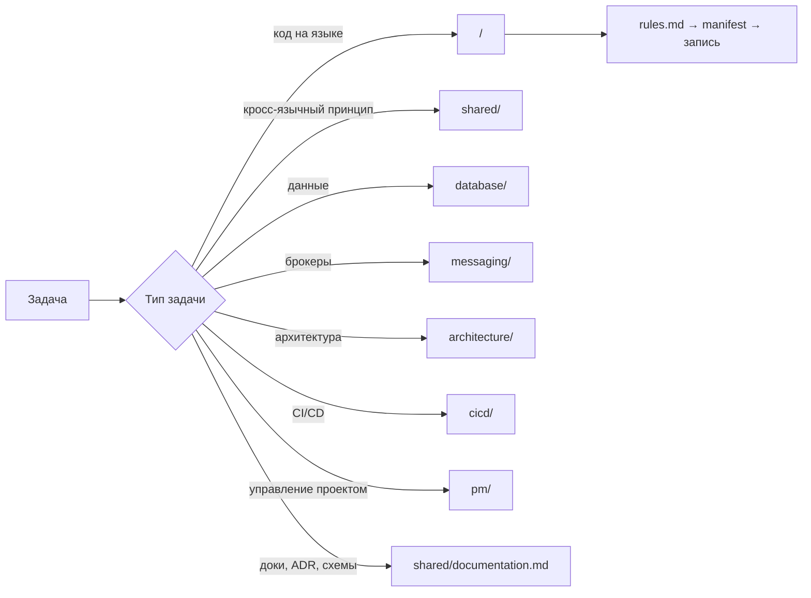

# awesome-coding

> **Для ИИ-агентов:** начните с [AGENTS.md](AGENTS.md) — роутер «задача → куда смотреть».
> Путь: `AGENTS.md` → раздел (`go/`, `shared/`, `database/`, …) → конкретная запись.
> Без клона файлы доступны по ссылкам GitHub/raw; поиск по каталогу — в `index/<section>.yaml`.

Библиотека сниппетов, паттернов и правил для **кодинг-агентов** (и людей).
Структурирована по языкам: **Go, TypeScript, JavaScript, Python, C, Bash, C#, Kotlin** +
разделы **Unity** (кроссплатформенные и Android-игры, HLSL), **shared** (кросс-языковые принципы),
**database** (PostgreSQL, Redis), **messaging** (Kafka, RabbitMQ), **cicd** (GitHub/GitLab, Docker, k8s).

## Почему agent-first

Основной потребитель репозитория — LLM-агент, а не человек. Отсюда дизайн:

- **Предсказуемая структура и имена** — агент читает только нужное, а не всё подряд.
- **YAML frontmatter** у каждой записи — метаданные для поиска (теги, версия, статус).
- **Высокая плотность сигнала** — «когда использовать / когда нет», Do/Don't-пары, pitfalls.
- **Закреплённые версии языков** — агент не пишет устаревшие идиомы.
- **`verified` — факт прогона** — код записей гоняется в CI настоящими тулчейнами
  (`make verify`: go build, tsc, gcc, shellcheck, node, python), а не «на веру».
- **`AGENTS.md`** — короткий «роутер» для агента, а не дамп контента.

## Роутинг агента

Как агент находит нужную запись (полный роутер — в `AGENTS.md`):



Примеры:

| Задача | Путь |
|---|---|
| HTTP-сервер на Go с ретраями | `go/snippets/http-server.md` + `go/rules.md` |
| Выбрать веб-фреймворк для Python | `python/decisions.md` → `python/snippets/web-server.md` |
| Задокументировать проект со схемами | `shared/documentation.md` + `shared/mermaid.md` |
| Провести ревью PR | `shared/code-review.md` |
| Надёжно публиковать события из транзакции | `messaging/snippets/outbox.md` |
| Начать проект с discovery, вести roadmap и память | `pm/sdlc.md` + `pm/roadmap.md` + `pm/project-memory.md` |

### Поиск без чтения файлов: MCP

`tools/mcp_server.py` — MCP-сервер (stdio) поверх каталога: `search(query, section)`
и `get(id)`. Клиент получает id, статус и `verified` из `index/*.yaml`, а текст —
только выбранной записи.

```bash
pi mcp add -l awesome-coding -- python3 tools/mcp_server.py   # в этом репо
python3 ~/.cache/awesome-coding/tools/mcp_server.py           # из кэша скилла
```

Локальный `.pi/mcp.json` в репозитории уже лежит; pi подхватит его после
подтверждения доверия к проекту. Того же требует и любой другой MCP-клиент:
`command: python3`, `args: [tools/mcp_server.py]`.

## Структура

```
awesome-coding/
├── AGENTS.md                  # точка входа для агента (роутер)
├── Makefile                   # make validate — проверки, make verify — прогон кода
├── tools/
│   ├── validate.py            # валидатор: frontmatter, каталог, текст, алиасы, ссылки
│   ├── find.py                # поиск: запрос по словам, алиасы, ранжирование
│   ├── verify_snippets.py     # код-блоки записей через тулчейны в Docker
│   ├── mcp_server.py          # MCP: search/get поверх index/*.yaml
│   ├── test_tools.py          # тесты туллинга (make test)
│   └── readme.py              # генерация блока «Статус разделов»
├── docs/
│   ├── FORMAT.md              # спецификация формата записей
│   ├── CONTRIBUTING.md
│   └── adr/                   # ADR — архитектурные решения репозитория
├── index/
│   ├── manifest.yaml          # шапка каталога: версии языков
│   ├── aliases.yaml           # синонимы для поиска: слово → id записей
│   └── <section>.yaml         # записи раздела (go, bash, shared, …)
├── go/                        # языковой раздел (эталонный)
│   ├── README.md              # версия, конвенции, quick-reference
│   ├── rules.md               # guardrails: do/don't (✅/❌)
│   ├── idioms.md              # идиоматичный Go
│   ├── decisions.md           # таблицы решений: что выбрать и когда
│   ├── snippets/              # готовые сниппеты
│   └── patterns/              # архитектурные/дизайн-паттерны
├── architecture/              # языконезависимая архитектура и DDD
│   ├── decisions.md           # какой уровень DDD / какая архитектура для проекта
│   ├── ddd/                   # tactical (entity, VO, aggregate, …) + strategic (bounded contexts)
│   └── patterns/              # layered, hexagonal, modular monolith, microservices, CQRS, ES, event-driven
├── typescript/                # (аналогичная структура)
├── javascript/
├── react/                     # React 19 + Vite 8 + Vitest 5 (поверх typescript)
├── python/
├── c/
├── bash/
├── csharp/                    # .NET 10 / C# 14
├── kotlin/                    # Kotlin 2.3 (JVM/Android)
├── unity/                     # Unity 6.3 LTS: кроссплатформа + Android
│   └── shaders/               # HLSL (URP)
├── shared/                    # кросс-языковые концепции (15 тем)
├── database/                  # PostgreSQL 18 + Redis 8
├── messaging/                 # Kafka 4.3, RabbitMQ 4.3
├── cicd/                      # GitHub Actions, GitLab CI, Docker, Kubernetes, secrets, matrix
├── agenting/                  # агентские автоматизации: расписание, замок, чекпоинт, охотник, DAG
└── pm/                        # SDLC, PMBOK, discovery, требования, риски, roadmap, PROJECT_MEMORY
```

## Версии (проверено 2026-11-24, `make check-versions`)

| Технология | Версия | Fallback |
|---|---|---|
| Go | 1.27 | 1.26 |
| TypeScript | 7.0 | 6.x |
| JavaScript | ES2025 | ES2024 |
| Python | 3.14 | 3.13 |
| C | C23 (ISO 9899:2024) | C17 |
| Bash | 5.3 | 5.2 |
| C# | .NET 10 (LTS) / C# 14 | .NET 9 / C# 13 |
| Kotlin | 2.3 | 2.2 |
| Unity | 6.3 LTS (6000.3.x) | 6.0 LTS |
| PostgreSQL | 18 (18.6) | 17 |
| Redis | 8 (8.10.1) | 8.0 |
| Kafka | 4.3 (4.3.1) | 4.2 |
| RabbitMQ | 4.3 (4.3.5) | 4.0 |

Обновление: `.github/workflows/freshness.yml` раз в неделю гоняет
`make check-versions` и `make check-stale` и держит один open issue со списком
кандидатов (чистый прогон закрывает его). Пины меняются вместе с
перепроверкой затронутых записей, а не только таблицы — решает человек. Итог проверки
2026-11-24 (вышли Python 3.15, Kotlin 2.4, PostgreSQL 19, RabbitMQ 4.4 — пины
оставлены) — в [AGENTS.md](AGENTS.md), раздел «Версии».

## Для контрибьюторов

- Формат записей: [docs/FORMAT.md](docs/FORMAT.md)
- Правила контрибьюции: [docs/CONTRIBUTING.md](docs/CONTRIBUTING.md)
- Валидация: `make validate` (frontmatter, каталог, индексы, структура записей, текст, README, ссылки)
- Проверка кода: `make verify` (go/tsc/python/node/shellcheck/gcc/PostgreSQL в Docker), `make verify-fix` —
  поднять `verified` там, где прогон доказал
- Релизы: [CHANGELOG.md](CHANGELOG.md) — теги `vN.N`; агенты пинят версию в скилле

## Статус разделов

Счётчики и версии генерируются из `index/*.yaml` (`make readme`), вручную не правятся.
«Код проверен» — записи с программным кодом, прошедшие прогон тулчейном
(`compiled`/`executed`, см. [docs/FORMAT.md](docs/FORMAT.md)). Вне `make verify` остаются
`csharp` — dotnet build; `kotlin` — kotlinc; `unity` — Unity Editor — там уровень ставится по фактической проверке.

| Раздел | Версия | Записей | Состав | Код проверен | Guardrails |
|---|---|---|---|---|---|
| `go/` | 1.27 | 27 | 20 сниппетов, 4 паттерна, 1 набор правил, 1 idioms, 1 таблица решений | 23/25 | rules.md |
| `typescript/` | 7.0 | 8 | 5 сниппетов, 1 набор правил, 1 idioms, 1 таблица решений | 6/6 | rules.md |
| `javascript/` | ES2025 | 7 | 4 сниппета, 1 набор правил, 1 idioms, 1 таблица решений | 5/5 | rules.md |
| `react/` | 19.3 | 11 | 8 сниппетов, 1 набор правил, 1 таблица решений, 1 паттерн | 7/8 | rules.md |
| `python/` | 3.14 | 10 | 7 сниппетов, 1 набор правил, 1 idioms, 1 таблица решений | 8/8 | rules.md |
| `c/` | C23 | 7 | 4 сниппета, 1 набор правил, 1 idioms, 1 таблица решений | 5/5 | rules.md |
| `bash/` | 5.3 | 7 | 4 сниппета, 1 набор правил, 1 idioms, 1 таблица решений | 5/5 | rules.md |
| `csharp/` | 14 (.NET 10) | 15 | 9 сниппетов, 3 паттерна, 1 набор правил, 1 idioms, 1 таблица решений | 13/13 | rules.md |
| `kotlin/` | 2.3 | 9 | 6 сниппетов, 1 набор правил, 1 idioms, 1 таблица решений | 2/7 | rules.md |
| `unity/` | 6.3 LTS | 18 | 12 сниппетов, 3 паттерна, 1 набор правил, 1 idioms, 1 таблица решений | 0/14 | rules.md |
| `shared/` | — | 17 | 12 концепций, 5 наборов правил | 1/4 | — |
| `architecture/` | — | 19 | 14 паттернов, 4 концепции, 1 таблица решений | 14/16 | — |
| `database/` | 18 (PostgreSQL) / 8 (Redis) | 9 | 7 сниппетов, 1 набор правил, 1 таблица решений | 7/7 | rules.md |
| `messaging/` | 4.3 (Kafka) / 4.3 (RabbitMQ) | 6 | 3 сниппета, 1 набор правил, 1 таблица решений, 1 паттерн | 4/4 | rules.md |
| `cicd/` | — | 10 | 9 сниппетов, 1 набор правил | 3/3 | rules.md |
| `pm/` | — | 8 | 3 паттерна, 2 концепции, 2 набора правил, 1 сниппет | — | — |
| `agenting/` | — | 8 | 3 сниппета, 3 паттерна, 1 набор правил, 1 таблица решений | 4/4 | rules.md |
| `llm/` | — | 7 | 4 сниппета, 1 набор правил, 1 таблица решений, 1 концепция | 4/4 | rules.md |
| **итого** | | **203** | | **111/138** | |

## License

[MIT](LICENSE)
